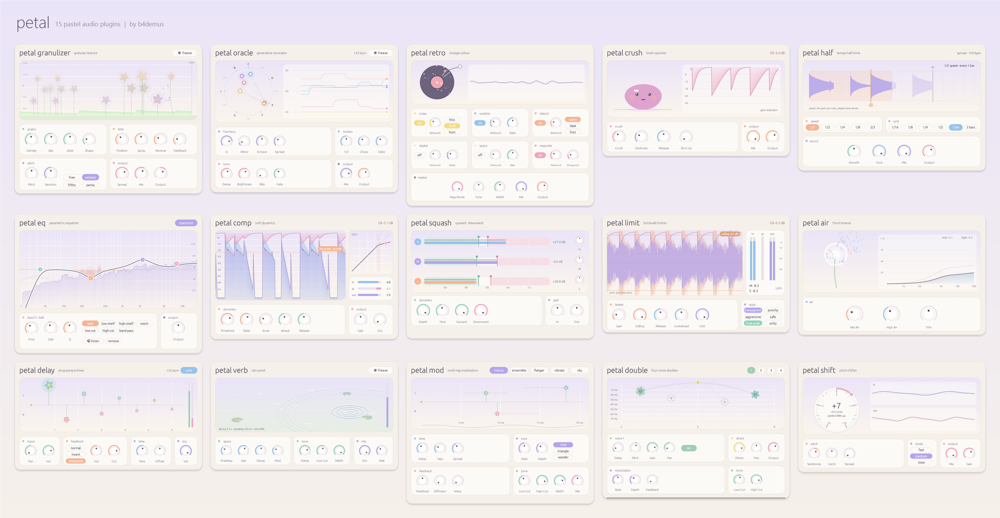

<div align="center">

# 🌸 petalbundle

**15 пастельных аудиоэффектов. Немного цвета для твоего звука.**

Гранулярные текстуры, генеративный резонатор, творческие эффекты и инструменты сведения — с общим оформлением и живыми визуализаторами.

[English](README.md) · **Русский**


[](LICENSE)

[Все плагины](#плагины) · [Установка](#установка) · [Сборка из исходников](#сборка) · [Скриншоты](docs/screenshots)

</div>

[](docs/all-plugins.png)

## Знакомься, Petal

Petal — набор аудиоэффектов для Windows, написанный на Rust с [nih-plug](https://github.com/robbert-vdh/nih-plug). У каждого плагина свой характер: гранулы раскрываются цветами, реверберация рисует круги на воде, а мягкая палитра и знакомые элементы управления связывают всё в одну коллекцию.

- **Создавай характер:** гранулярная обработка, генеративный резонатор, лоу-фай окраска и халфтайм с синхронизацией по темпу.
- **Добавляй пространство и движение:** дилей, реверберация, многоотводная модуляция, четырёхголосый даблер и питч-шифтер.
- **Собирай микс:** восьмиполосный эквалайзер, компрессия, многополосная динамика, лимитер и обработка высоких частот.

## Плагины

Нажми на название плагина, чтобы открыть его скриншот в полном размере.

| Плагин | Что делает |
| :--- | :--- |
| [Petal Granulizer](docs/screenshots/petal-granulizer.png) | Гранулярные текстуры: position и spray, реверс, случайный питч с квантованием и freeze. |
| [Petal Oracle](docs/screenshots/petal-oracle.png) | Генеративный резонатор: шесть «струн» движутся по нотам выбранной тональности и лада; chaos, glide и freeze. |
| [Petal Retro](docs/screenshots/petal-retro.png) | Лоу-фай окраска: шум, детонация, искажения, цифровая деградация, пространство и магнитные эффекты. |
| [Petal Crush](docs/screenshots/petal-crush.png) | Лэвел-крашер с настройками darkness, release, «Shut Up», mix и output. |
| [Petal Half](docs/screenshots/petal-half.png) | Халфтайм с синхронизацией по темпу, выбором скорости и сетки, сглаживанием и тоном. |
| [Petal EQ](docs/screenshots/petal-eq.png) | Параметрический эквалайзер на восемь полос с анализатором спектра и прослушиванием отдельной полосы. |
| [Petal Comp](docs/screenshots/petal-comp.png) | Компрессор с threshold, ratio, knee, attack, release, компенсацией громкости и бегущим дисплеем уровней. |
| [Petal Squash](docs/screenshots/petal-squash.png) | Трёхполосная компрессия вверх и вниз с отдельными настройками полос. |
| [Petal Limit](docs/screenshots/petal-limit.png) | Брикволл-лимитер с lookahead, выбором стиля, режимом true peak и измерением LUFS. |
| [Petal Air](docs/screenshots/petal-air.png) | Динамический «воздух» на высоких частотах: mid air, high air и trim. |
| [Petal Delay](docs/screenshots/petal-delay.png) | Стереодилей с обычной, инвертированной и ping-pong обратной связью, фильтрацией и синхронизацией по темпу. |
| [Petal Verb](docs/screenshots/petal-verb.png) | Алгоритмическая реверберация: predelay, размер, затухание, модуляция, демпфирование, ширина и freeze. |
| [Petal Mod](docs/screenshots/petal-mod.png) | Многоотводная модуляция со стилями chorus, ensemble, flanger, vibrato и sky. |
| [Petal Double](docs/screenshots/petal-double.png) | Четырёхголосый даблер с отдельными delay, pitch, gain и pan, модуляцией и обратной связью. |
| [Petal Shift](docs/screenshots/petal-shift.png) | Питч-шифтер: полутона, центы, стереоразброс и режимы fast, medium и slow. |

Подробнее: [параметры и визуализатор Granulizer](petal-granulizer/README.md) · [дизайн-система](DESIGN.md).

## Установка

В репозитории лежат исходники. [Собери плагины](#сборка), чтобы получить VST3- и CLAP-бандлы в папке `dist/`.

**VST3**

1. Закрой DAW. Запусти `install.cmd` из папки проекта: он запросит права администратора и при необходимости подождёт закрытия FL Studio.
2. Установщик скопирует VST3-бандлы из `dist/` в `C:\Program Files\Common Files\VST3`.
3. Открой DAW и пересканируй плагины.

Команда `install.cmd /dry` покажет план установки. Для ручной установки скопируй каждую папку `Petal Name.vst3` целиком в указанную выше папку VST3.

**CLAP**

Скопируй файлы `.clap` из `dist/` в папку, которую твоя DAW сканирует для CLAP, и запусти повторное сканирование. `install.cmd` устанавливает только VST3.

## Сборка

Нужны **Windows x64**, стабильный [Rust](https://rustup.rs) и соответствующий нативный линкер/тулчейн: например, MSVC Build Tools или MinGW для GNU-таргета.

```powershell
git clone https://github.com/b4demus/petalbundle.git
cd petalbundle

# Собрать все 15 плагинов и упаковать в dist/
powershell -ExecutionPolicy Bypass -File build.ps1

# Собрать только один плагин
powershell -ExecutionPolicy Bypass -File build.ps1 -Only petal-eq
```

Для каждого плагина создаются бандл `.vst3` и файл `.clap`. Результаты сборки исключены из Git.

<details>
<summary><strong>Портативный GNU-тулчейн</strong></summary>

По умолчанию `build.ps1` использует системный `cargo`. Для портативной сборки Windows GNU задай `PETAL_TOOLCHAIN` — путь к папке с `cargo/`, `rustup/` и `gcc/w64devkit/`. Скрипт также проверяет такую структуру в `../.tools/rust-daw`.

Пустой архив `.cargo/libstub/libgcc_eh.a` используется в этом варианте с w64devkit; скрипт сборки сам задаёт для него `LIBRARY_PATH`.

</details>

### Разработка

Тесты DSP:

```powershell
cargo test --workspace --lib
```

Превью интерфейса без DAW — со встроенным тестовым сигналом и dummy-бэкендом, без вывода звука:

```powershell
cargo run --release -p petal-eq --features standalone --bin petal-eq-standalone --target-dir target-standalone -- --backend dummy
```

### Структура проекта

| Путь | Содержимое |
| :--- | :--- |
| `petal-*/` | Отдельные плагины: DSP, параметры, интеграция с nih-plug, интерфейсы и самостоятельные превью. |
| `shared/` | Крейт `bundle_ui`: палитра, крутилки, карточки, кнопки и масштабирование окна. |
| `docs/` | Общий коллаж и скриншоты каждого плагина. |
| `build.ps1` / `install.cmd` | Сборка бандлов для Windows и установка VST3. |

Чтобы добавить плагин, внеси его крейт в workspace корневого `Cargo.toml` и в таблицу `$plugins` файла `build.ps1`. Чек-лист — в [DESIGN.md](DESIGN.md).

## Лицензия и авторство

**[GPL-3.0-or-later](LICENSE)** — как указано в манифестах крейтов. Проект использует [nih-plug](https://github.com/robbert-vdh/nih-plug) и его интеграцию с egui. VST3-биндинги nih-plug распространяются под GPLv3.

Автор — [b4demus](https://github.com/b4demus). Названия сторонних продуктов, используемые как ориентиры по звучанию, принадлежат их владельцам; Petal с ними не связан.
